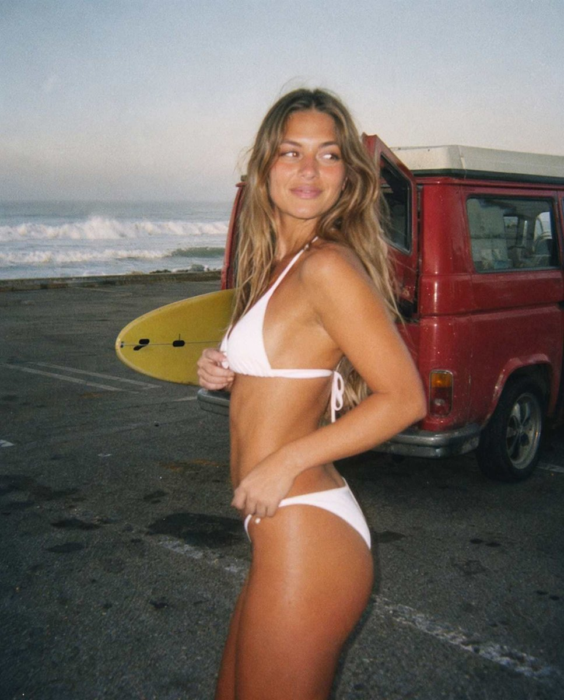
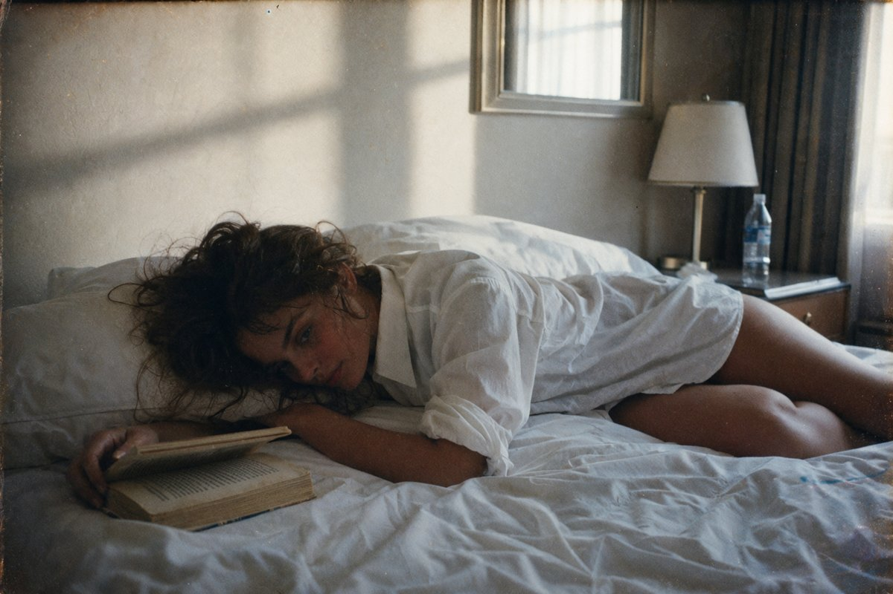
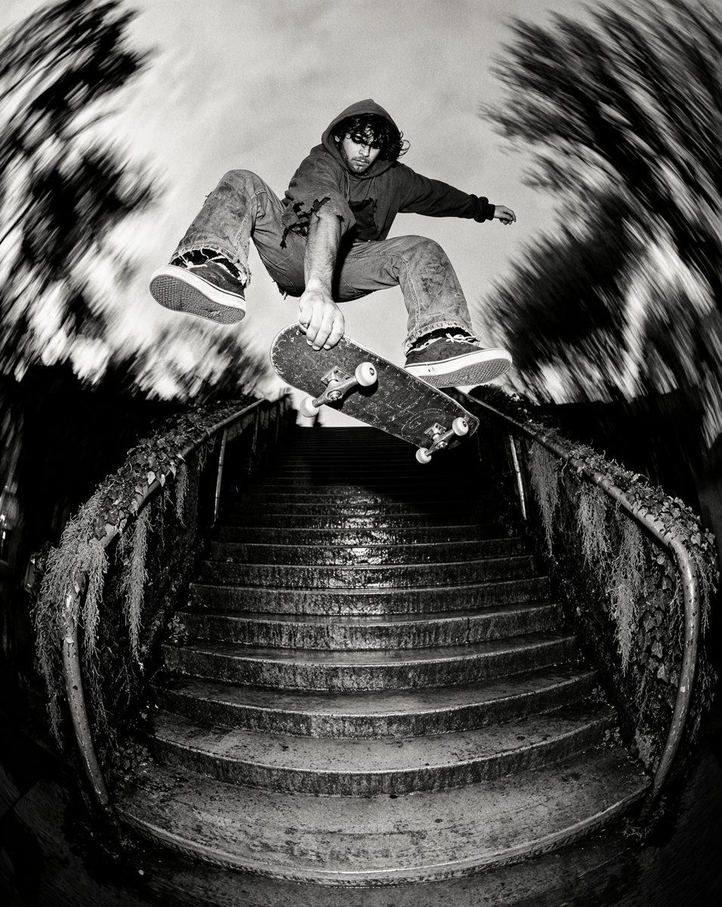
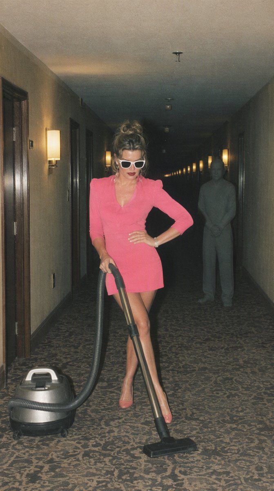
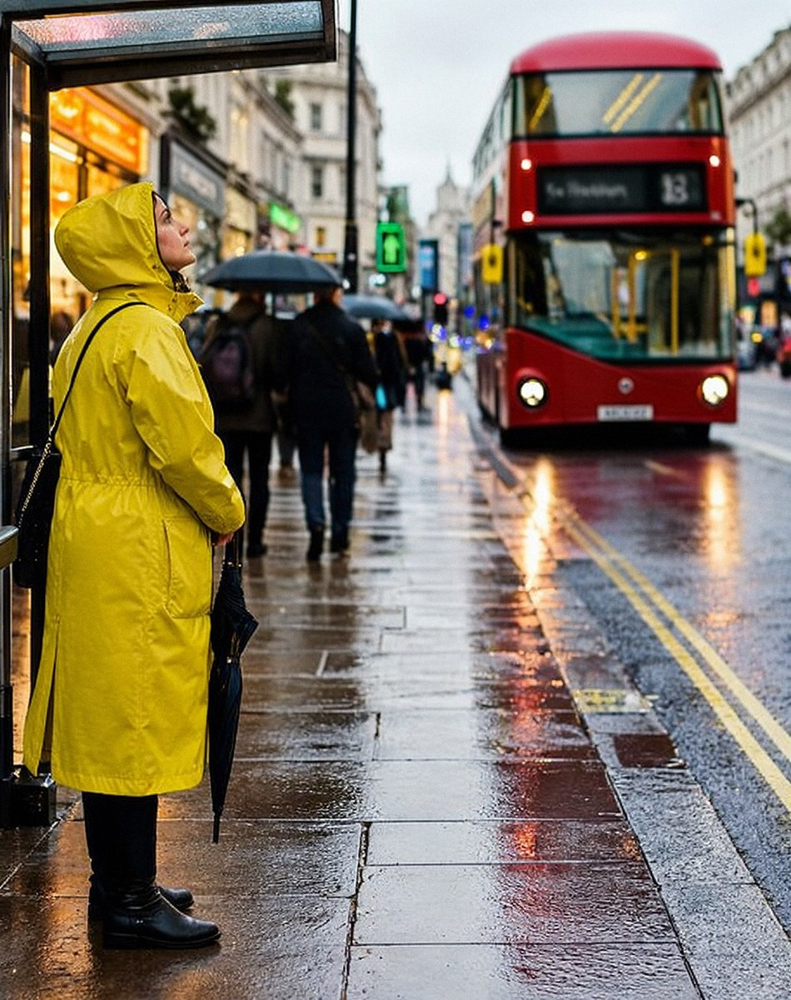
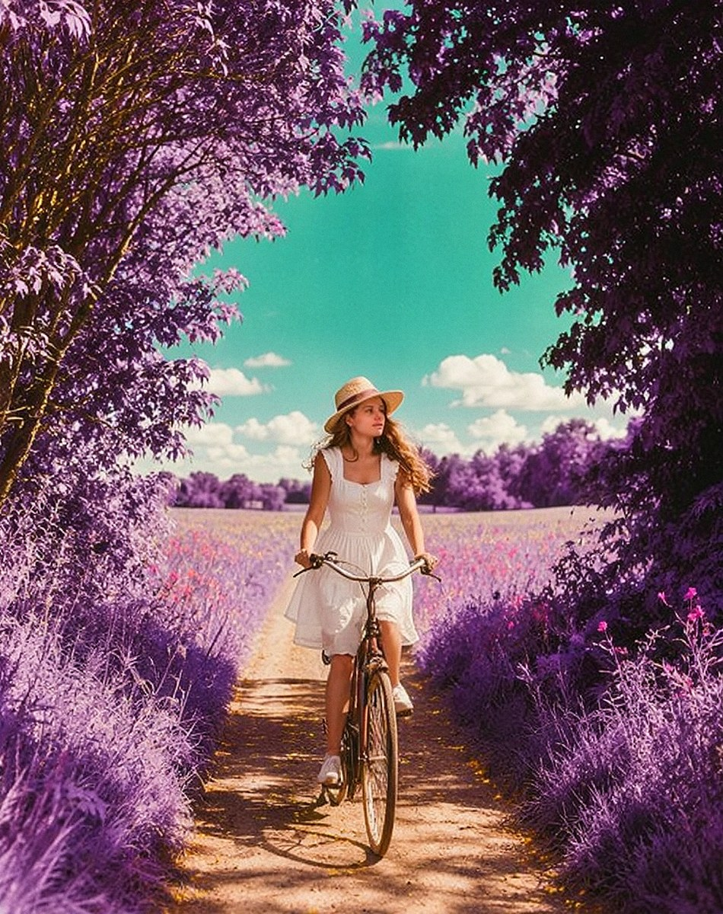
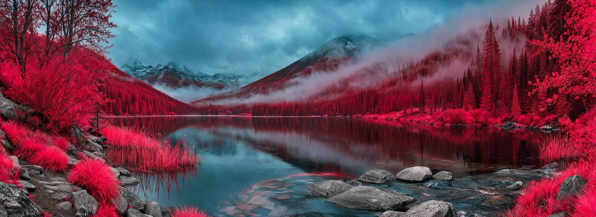

# Kreative Studio + Moss Film Looks for ComfyUI

Type a simple idea and get a finished photo in a film or phone look.

This repo has two things:
- **The Moss Film Looks workflow (v6).** It turns a short idea into a full picture with the **MOSS-Image** model, then adds film looks, face fix, detail and grain.
- **The Kreative Studio nodes.** They give the workflow its Control Panel, seed buttons, ON/OFF switches and **KEEP / BIN** buttons.

## Examples

| | | |
|---|---|---|
|  |  |  |
| **C · Cheap iPhone** · 35mm · face fix · JPEG crunch | **B · 1970s Kodachrome** · 50mm | **H · Tri-X 400** · 8mm fisheye · camera flash · face fix · Detail |
|  |  |  |
| **J · Polaroid** · camera flash | **A · Clean** · 50mm · face fix | **K · LomoChrome Purple** · 50mm · face fix |


**D · Aerochrome (prompt)** · XPan 45mm panoramic

> ⚠️ **Aerochrome IR (Look E) is experimental. Please don't use it yet.**
> Work on it is still going on. The **comfyui_aerochrome** node is included so the workflow loads, and so anyone who wants to can look at the code and suggest fixes (open an **Issue** on [its page](https://github.com/Lo-res/comfyui_aerochrome)).
> For the infrared look, use **Look D · Aerochrome**. Don't switch D and E on together: two colour swaps make a yellow and violet mess.

---

## Contents
1. [What you need](#1-what-you-need)
2. [Install the custom nodes](#2-install-the-custom-nodes)
3. [Download the models](#3-download-the-models)
4. [Open the workflow](#4-open-the-workflow)
5. [How to use it](#5-how-to-use-it)
6. [Problems?](#6-problems)

---

## 1. What you need
- **ComfyUI**, a recent version that supports **MOSS-Image** and **subgraphs**. Update it first.
- **ComfyUI-Manager**. Most installs already have it.
- An **NVIDIA graphics card**. Tested on an RTX 5060 Ti 16 GB with 32 GB RAM.
- About **20 GB of free disk space** for the models.

---

## 2. Install the custom nodes

You need **3 packs by Lo** and **7 packs from ComfyUI-Manager**.

### 2a. Lo's packs (install from GitHub)

| Pack | What it does | Link |
|---|---|---|
| **ComfyUI-Kreative-Studio** (this repo) | Control Panel, Model Panel, seed, ON/OFF, detail mix, JPEG crunch, KEEP / BIN | `https://github.com/Lo-res/ComfyUI-Kreative-Studio` |
| **ComfyUI-Kreative-Moss** | Idea list, size + lens (incl. XPan and Widelux), timers | `https://github.com/Lo-res/ComfyUI-Kreative-Moss` |
| **comfyui_aerochrome** | Look E (🧪 experimental, don't use yet) | `https://github.com/Lo-res/comfyui_aerochrome` |

Install **all three**. The workflow needs them all, even if you never use Look E.

Pick **one** way to install:

**Way 1: ComfyUI-Manager (easiest)**
1. Click **Manager** → **Install via Git URL**.
2. Paste the link from the table. Click **OK**.
3. Do the same for the other two links.

> If Manager says the **security level** is too high: open `ComfyUI/user/default/ComfyUI-Manager/config.ini`, change `security_level = normal` to `security_level = weak`, restart ComfyUI and try again. Set it back afterwards.

**Way 2: git (if you use the command line)**
```
cd ComfyUI/custom_nodes
git clone https://github.com/Lo-res/ComfyUI-Kreative-Studio
git clone https://github.com/Lo-res/ComfyUI-Kreative-Moss
git clone https://github.com/Lo-res/comfyui_aerochrome
```

**Way 3: download ZIP**
1. On each repo page, click the green **Code** button → **Download ZIP**.
2. Unzip it into `ComfyUI/custom_nodes/`.
3. **Remove `-main` from the end of the folder name.** For example, `ComfyUI-Kreative-Studio-main` → `ComfyUI-Kreative-Studio`.

### 2b. Packs from ComfyUI-Manager
Click **Manager** → **Custom Nodes Manager**, search for each name and click **Install**:
- **rgthree-comfy**
- **ComfyUI-Impact-Pack**
- **ComfyUI-Impact-Subpack**
- **ComfyUI-SeedVR2_VideoUpscaler** (by numz)
- **ComfyUI-Pixaroma**
- **comfyui-propost**
- **ComfyUI_essentials** (by cubiq; black and white finish for Tri-X)

### 2c. Restart
**Close ComfyUI and start it again. Then refresh your browser** (Ctrl + F5).
Do this every time you install or update a pack.

---

## 3. Download the models

| What | Put it in `ComfyUI/models/…` | Download |
|---|---|---|
| Moss image model (SFT, int8, 5.4 GB) | `diffusion_models/Moss/` | [Comfy-Org/MOSS-Image](https://huggingface.co/Comfy-Org/MOSS-Image) → `moss_image_sft_int8_convrot.safetensors` |
| Moss text encoder | `text_encoders/` | [Comfy-Org/MOSS-Image](https://huggingface.co/Comfy-Org/MOSS-Image) → `qwen3.5_9b_w4a8_gptq.safetensors` |
| Moss VAE | `vae/` | [Comfy-Org/MOSS-Image](https://huggingface.co/Comfy-Org/MOSS-Image) → `flux2-vae_small.safetensors` |
| Prompt writer (5.2 GB) | `text_encoders/` | [Huihui Qwen3-VL 4B abliterated (comfy)](https://huggingface.co/ahmed22xa/Huihui-Qwen3-VL-4B-Instruct-abliterated-comfy) → the `fp8_scaled` file |
| Face finder | `ultralytics/bbox/` | [Bingsu/adetailer](https://huggingface.co/Bingsu/adetailer) → `face_yolov8m.pt` |
| SeedVR2 3B fp8 + VAE (3.19 GB) | `SEEDVR2/` | **Downloads itself** the first time you use Detail. Or get it from [numz/SeedVR2_comfyUI](https://huggingface.co/numz/SeedVR2_comfyUI) |
| LoRAs (optional) | `loras/` | Your own |

```
ComfyUI/models/
├── diffusion_models/Moss/moss_image_sft_int8_convrot.safetensors
├── text_encoders/qwen3.5_9b_w4a8_gptq.safetensors
├── text_encoders/Huihui-Qwen3-VL-4B-Instruct-abliterated-fp8_scaled.safetensors
├── vae/flux2-vae_small.safetensors
├── ultralytics/bbox/face_yolov8m.pt
└── SEEDVR2/   (fills itself)
```

**File names don't match?** That's fine. After you open the workflow, pick your files in the **MODEL PANEL**.

---

## 4. Open the workflow
1. Find the workflow file in this repo's `workflows/` folder: **`moss-image-sft_v6_A_compact.json`**.
2. Drag it onto the ComfyUI window.
3. **Red nodes?** A pack is missing. Click **Manager** → **Install Missing Custom Nodes**, then restart.
4. In the **MODEL PANEL**, check that each box shows your model file.

This is the only workflow in the repo, so there's nothing else to pick.

---

## 5. How to use it

### The 4 steps
1. **1a Your idea.** Type it. Click **ON** next to the row you want.
2. **CONTROL PANEL.** Pick a **look** and **people**. Set **steps**. Switch the extras **ON** or **OFF**.
3. **1c Size.** Pick a shape. A lens is optional.
4. Press **Run** (Ctrl + Enter).

Like the picture? Press **💾 KEEP** on the RESULT node.
**Nothing is saved until you press KEEP.** Kept pictures go in `ComfyUI/output/`.
Don't like it? Press **🗑 BIN**.

### The looks (switch one on)
| Look | What you get |
|---|---|
| **A · Clean** | No film look. |
| **✏️ Your own style** | Type any film or camera look. Start with one short sentence naming it, then describe the colours, grain and light. Describe colours as they **look in the photo** ("violet leaves, teal sky"), not as changes ("greens turn violet"). The example in the box is Fujifilm Velvia 50. |
| **B · 1970s Kodachrome** | Warm, faded 70s snapshot. |
| **C · Cheap iPhone** | Grainy phone photo. JPEG crunch is always on. |
| **D · Aerochrome** | Infrared film look: living plants glow crimson and pink, water goes black, and stone, brick, metal and clothes keep their own colours. A colour guide tells the prompt writer what colour everything should be. |
| **E · Aerochrome IR** | 🧪 **Experimental. Don't use it yet.** |
| **G · Kodak Portra 400** | Classic Portra colour: creamy pastel highlights, sage greens, pastel cyan skies, coral reds, golden-peach skin and soft lifted shadows. A colour guide tells the prompt writer how Portra renders each colour. |
| **H · Kodak Tri-X 400** | Classic black and white, **always**. Colour words in your idea are removed, the prompt writer describes tones only, and the finished picture is turned fully grey. |
| **I · CineStill 800T** | Night film: cool blues, warm lights, red glow round lamps. |
| **J · Polaroid** | Soft instant photo. Sharpen, Detail and lens switch off by themselves. |
| **K · LomoChrome Purple** | Lomography's purple film: leaves, grass and hedges turn violet and lavender, the sky goes teal, yellows go pink, skin stays natural. A colour guide tells the prompt writer what colour everything should be, so Moss paints it that way. |

**📸 Camera flash** adds an on-camera flash to any look.

The prompt writer reads the look you pick, so it describes the scene in that film's colours (for example, no "green trees" on a film that turns greens purple).

### People (switch ONE on)
**Why this is here:** if your idea doesn't say what the people look like, the Moss model usually draws Asian people.
These switches give you control over that.

- **A · Caucasian**: on by default. Used when your idea doesn't say.
- **B · Asian**: used when your idea doesn't say.
- **C · As in my idea**: follows your words exactly. Good for mixed groups, or to describe people yourself.
- **D · No people**: places and things only.

### My prompt (1n): write the prompt yourself
Under the Control Panel there is a **MY PROMPT** box. Use it when you want full control, for example for **LoRA trigger words**.

1. Switch **AI prompt writer** to **OFF**. The AI writer is skipped completely, so runs are faster.
2. Type your prompt in a row and switch the row **ON**. **+ Add prompt / − Remove prompt** add and remove rows.
3. Press **Run**.

- **Several rows ON = several pictures.** One press of Run makes one picture per ON row, each its own run with **KEEP / BIN**.
  Set **selection_mode** to **Combine ON rows into one prompt** to join the ON rows into one prompt instead.
- Your prompt goes **first**, exactly as you wrote it (put trigger words at the start).
- **add look + lens text ON:** the look, lens and flash text are added after your prompt. **OFF:** Moss gets only your prompt.
- With the writer OFF, the colour guides and the **People** switches don't apply (they are instructions for the AI writer).
  Everything else still works: seed, size, negative, LoRAs, second pass, face fix, detail, grain and KEEP / BIN.
- Same seed + same prompt = the same picture every time.

### Size and lens (1c)
Pick a shape and a size. A lens changes the feel of the picture.
Two panoramic lenses are always wide:
- **XPan 45mm**: cinema letterbox (65:24).
- **Widelux 26mm**: 140° swing lens, gently curved horizon (3:1).

Use size **2304** or **2560** with these, so the picture isn't too short.

**Fixed lens:** the **J · Polaroid** look has its own built-in lens, just like the real camera.
With Polaroid, the lens choice in 1c doesn't apply. Your lens comes back when you pick another look.

### Seed (1e)
The seed is the picture's ID number.
- **🔒 Keep this seed**: same settings give the same picture.
- **🎲 New seed each run**: a new picture every time.
- **➕ 1 / ➖ 1**: a close cousin of the picture.
- **↩ Previous seed**: go back one step.

### Extras
- **Steps**: 25 = quick test, 50 = best.
- **Second pass**: a finer polish. Slower.
- **Face fix**: redraws small or far-away faces.
- **Detail (SeedVR2)**: sharper fine detail. **detail_mix** 0 = keep the grit, 1 = full clean-up. Start at 0.5.
  ⏳ The first run is slow because it loads a 3.19 GB model.
- **JPEG crunch**: phone-style compression, for any look.

**Quick test:** Second pass, Face fix and Detail **OFF**, steps **25**.
**Best quality:** all **ON**, steps **50**.

### Colours in the workflow
🟩 green = yours to change · 🟦 blue = automatic · 🟨 gold = result

---

## 6. Problems?
- **Red nodes / "missing node types":** a pack isn't installed. See step 2, then restart.
- **Out of memory:** switch **Detail OFF** first. Or lower the detailer's resolution from 1536 to 1280.
- **Buttons or panel look wrong after an update:** restart ComfyUI, then refresh the browser with **Ctrl + F5**.
- **Model box is empty or red:** pick your file in the **MODEL PANEL**.

Found a bug? Open an **Issue** on this page (the **Issues** tab at the top).

---

## Licence
MIT: free for anyone to use, change and share. See [LICENSE](LICENSE).

Made by **Lo** · [kreative2ai](https://github.com/Lo-res)
